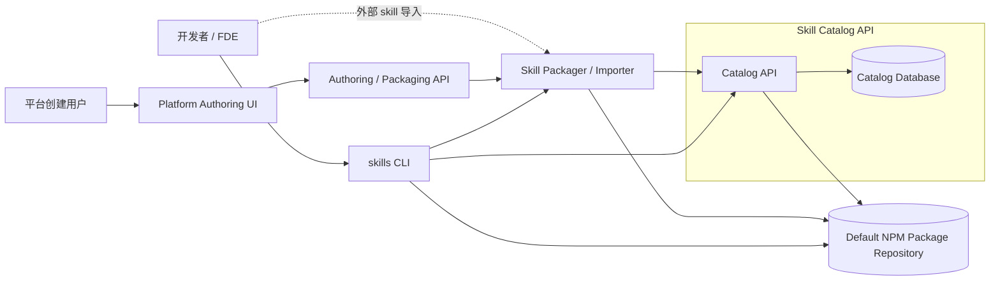

# Agent Skill Registry V1 主规范

## 文档定位

本文是 V1 的主入口和主规范。

它只保留需要稳定达成一致的内容：

- 系统边界
- 领域模型
- 核心原则
- 端到端主流程
- 对外 API / CLI 轮廓
- 生命周期与非目标

实现级细节、补充论证和兼容性说明拆分到其他专项文档。

补充说明：

- 当前实现已移除早期的 `experimental_install`、`experimental_sync` 与 `node_modules` 同步入口
- V1 公开主路径只保留 `registry-first`

## 系统定位

V1 的首要目标是定义一个 `Registry Core`：

- 对外以 `skill` 为产品对象
- 对内以 `single-skill bundle` 为分发单元
- 以 Catalog 作为发现、治理和 install target 解析的真相源

V1 不试图把“本地如何安装、落到哪里、如何跨 runtime 统一多 scope 语义”也纳入同一个领域模型。

这些语义如果存在，应被视为消费侧 `Local Installer Adapter` 的职责。

因此，V1 的正式设计应优先以本文为准；其余文档只负责展开某个子问题，不再与本文并列争夺“总方案”地位。

关联文档：

- [API 与 CLI 契约](./2026-05-28-agent-skill-registry-api-cli-contracts.zh-CN.md)
  主规范的对外契约展开
- [Catalog API 详细设计](./2026-05-28-agent-skill-registry-catalog-api-detailed-design.zh-CN.md)
  服务端实现级接口细节
- [Catalog API OpenAPI](./2026-05-28-agent-skill-registry-catalog-api.openapi.yaml)
  机器可读接口草案
- [Skill Packager / Importer 详细设计](./2026-05-28-agent-skill-registry-skill-packager-importer.zh-CN.md)
  bundle 生成与校验规则
- [发布、登记与治理详细设计](./2026-05-28-agent-skill-registry-publish-release-governance.zh-CN.md)
  publish、release record、governance 状态机
- [Local Installer Adapter 详细设计](./2026-05-28-agent-skill-registry-local-installer-adapter.zh-CN.md)
  消费侧本地安装补充语义
- [与 skills.sh 的兼容性边界说明](./2026-05-28-agent-skill-registry-skills-sh-compatibility.zh-CN.md)
  对外定位边界

## 文档层级

当前文档集按下列层级理解：

1. 本文
   V1 主规范，优先级最高
2. 契约与实现文档
   API / CLI、Catalog API、OpenAPI
3. 子域补充文档
   packager、publish/governance、local installer、兼容性

## 目标

- 对外保持 `skill` 的产品心智。
- 对内使用 `single-skill bundle` 作为分发单元。
- 复用 npm-compatible 仓，不重造制品分发协议。
- 让 Catalog 成为搜索、治理和 install target 解析的真相源。
- 把本地安装视为消费侧 adapter，而不是 Registry 核心领域对象。

## 非目标

- agent 运行时如何加载 skill
- 本地多 scope 安装策略如何跨 runtime 标准化
- 脚本依赖安装与执行
- 多租户复杂权限系统
- `skills.sh` 的 source-first 安装协议
- 完整供应链闭环

## 核心抽象

### Agent Skill

面向用户的逻辑能力单元。用户搜索和安装的对象是 skill，而不是 bundle。

### Package Name

V1 唯一公开身份。publishable skill package 必须使用保留 scope，例如 `@platform.skill/pdf-skill`。

### Agent Skill Version

某个 skill 的一次不可变发布。`package_name + version` 必须代表唯一内容。

### Skill Bundle

制品级分发抽象。V1 只允许 `single-skill bundle`。

### SKILL.md

作者维护的人类可读说明文件，只承载最小稳定元数据。

### package.json

分发身份文件，承载 `package_name`、`version` 以及可选的内部 publish 约束。

### Skill Packager / Importer

把本地目录、平台创建输入或外部 skill 源内容收敛成统一 publishable bundle 的能力层。

### NPM Package Repository

存储 tarball 和 npm 包版本元数据的内部仓。

### Skill Catalog API

负责搜索、详情、install target 解析、发布登记和治理的服务端真相源。

### Local Installer Adapter

消费侧本地能力。负责根据 install target 下载 bundle、解包，并放到某个 runtime 约定的可发现位置。

它可以由 CLI 承载，也可以由其他 runtime-specific 安装器承载；它不属于 Registry Core 的领域真相源。

## 核心原则

### 公开身份只认 Package Name

系统不暴露 repo path、source alias 或第二套外部身份。

### Catalog 管治理，npm 仓管制品

npm 仓只负责存储；可搜索、可安装、可治理都由 Catalog 决定。

### 先生成合法 bundle，再谈发布

所有输入路径都必须先收敛到统一 bundle 规范，再进入 publish。

### V1 主动收敛复杂度

V1 不追求一开始就支持多仓路由、多 skill pack、semver range 或复杂审批流。

### Registry Core 不建模本地安装策略

Catalog 只负责 install target 解析，不负责本地 scope、winner 或 discoverable state 的统一建模。

这些语义若存在，应归属于 `Local Installer Adapter` 的本地策略，而不是 Registry Core 的公开领域模型。

## 端到端主链路

1. Authoring / Packaging layer 接收本地创建、平台创建或外部导入的源内容。
2. `Skill Packager / Importer` 生成规范化 bundle 工作目录，补齐 `SKILL.md` 与 `package.json`，并执行结构校验。
3. CLI 或平台后端将 bundle 发布到内部 npm-compatible 仓。
4. 发布方调用 `PUT /api/v1/skills/{packageName}/versions/{version}/release-record`，由 Catalog 服务端复检并登记。
5. 用户通过 `skills find` 或 Catalog 读接口发现 skill。
6. 消费端通过 install target 解析接口获取 install target。
7. `Local Installer Adapter` 从内部 npm 仓下载 bundle，并把它落到某个 runtime 可发现位置。

## 组件职责

### Authoring / Packaging Layer

- 接收作者输入或导入源
- 生成 bundle
- 校验 bundle 合法性

### Skill Packager / Importer

- 生成或重写 `package.json`
- 规范化 `SKILL.md`
- 处理导入映射
- 产出工作目录或 `.tgz`

### NPM Package Repository

- 存储 tarball
- 保存 npm 包元数据
- 为安装端提供下载能力

### Skill Catalog API

- skill 搜索与详情
- version 列表
- install target 解析
- release record
- governance change

### Catalog Database

- 保存 skill 记录
- 保存 version 记录
- 保存治理记录

### Local Installer Adapter / CLI

- scaffold
- 搜索 / 查看 / 发布
- 安装 / 更新 / 删除 / 列表
- 可选维护本地 scope、winner 和 discoverable state

## 系统架构图

## 生命周期总览

### Skill 级

- `active`
- `retired`

### Version 级

- `published`
- `deprecated`
- `yanked`

## V1 的刻意收敛

- 单公开身份
- 单默认 npm 仓
- `single-skill bundle`
- 只定义 registry-first 分发模型
- 不定义 project-level dependency model
- 精确版本或默认 latest
- 最小权限模型
- 关系型 Catalog 数据库最小搜索实现

## 后续演进空间

- 若未来引入项目级依赖模型，再评估 `skill lockfile`
- 异步 job 化的 authoring / packaging API
- 导入审核流和 install policy 状态机
- source export 工具链
- 多仓 / 多源运行时解析
- 更细权限和搜索后端抽象
