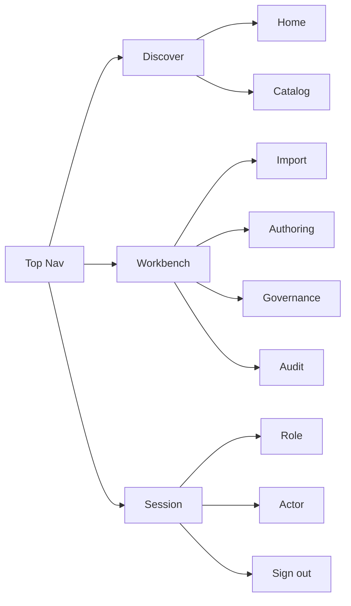

# Skill Registry Web 按 skills.sh 风格重排的信息架构图

## 目标

把当前 `registry-first` 的 Web 端重新组织成更接近 `skills.sh` 的阅读心智：

- 前台先回答：有什么 skill、值不值得装、当前推荐哪一个
- 后台再承接：import、authoring、release review、governance、audit
- 登录与权限作为单独的 `auth seam`，不要和前后台叙事混在一起

这份文档**只重排 read-side / discovery-side 信息架构**，不改变：

- **Package Name** 作为唯一公开身份
- Catalog 作为 **Registry Entry Point**
- `release-record` / `install-target` / governance 这套 control plane
- `registry-first` 而不是 `source-first`

## 当前问题

当前 `apps/skills-web` 已经具备可用功能，但信息架构还是偏“单壳控制台”：

- `OverviewPage` 同时讲 discovery、operator context、governance、audit
- `AppShell` 同时挂前台与后台导航，reader 和 operator 只是裁剪显示项
- `/catalog`、`/skills/:packageName` 这些前台阅读页和 `/import`、`/governance` 这些后台操作页没有明显分区
- `RouteGuards`、`PermissionGate`、导航裁剪都直接消费 action string，`auth seam` 还偏浅

结果是：能用，但 reader 视角和 operator 视角还没有真正分层。

## 重排原则

参考 `skills.sh`，只借三件事：

1. Discovery-first
2. Skill detail 是主入口，不是后台列表的附属页
3. Install / use / update 这些“下一步动作”要贴着 skill 内容出现

不借：

1. `owner/repo` 身份
2. source-first install
3. 用 source locator 代替 **Package Name**

## 目标信息架构

```mermaid
flowchart TD
    A[Skill Registry Web] --> B[Frontstage Reader Surface]
    A --> C[Backstage Operator Surface]
    A --> D[Auth Seam]

    B --> B1[/]
    B --> B2[/catalog]
    B --> B3[/skills/:packageName]
    B --> B4[/skills/:packageName/versions/:version]

    B1 --> B1a[Featured skills]
    B1 --> B1b[Curated lanes]
    B1 --> B1c[Recommended next step]

    B2 --> B2a[Search]
    B2 --> B2b[Filter]
    B2 --> B2c[Result cards]

    B3 --> B3a[Skill summary]
    B3 --> B3b[Latest published version]
    B3 --> B3c[Install and use hints]
    B3 --> B3d[Version timeline]

    B4 --> B4a[Version release state]
    B4 --> B4b[Compatibility and warnings]
    B4 --> B4c[Governance posture]

    C --> C1[/workbench]
    C --> C2[/workbench/import]
    C --> C3[/workbench/authoring]
    C --> C4[/workbench/governance]
    C --> C5[/workbench/audit]

    C1 --> C1a[Operator queue]
    C1 --> C1b[Release review]
    C1 --> C1c[Governance pressure]

    D --> D1[/login]
    D --> D2[session provider]
    D --> D3[reader posture]
    D --> D4[operator posture]
```

## 路由重排图

### 现状

```text
/
/catalog
/skills/:packageName
/skills/:packageName/versions/:version
/authoring
/import
/governance
/audit
/login
```

### 目标

```text
Frontstage
/
/catalog
/skills/:packageName
/skills/:packageName/versions/:version

Backstage
/workbench
/workbench/import
/workbench/authoring
/workbench/governance
/workbench/audit

Auth seam
/login
```

这里关键不是“多几个路由”，而是把 reader 心智和 operator 心智拆开：

- Frontstage 面向 **Reader Role**
- Backstage 面向 **Publisher Role / operator**
- `auth seam` 只负责把当前 session 映射成 `reader posture` 或 `operator posture`

## 页面职责重排

| 当前页面 | 当前问题 | 目标位置 | 重排后的职责 |
| --- | --- | --- | --- |
| `OverviewPage` | discovery 和 operator signal 混在一起 | `/` + `/workbench` | 首页只讲 discovery；operator signal 挪去 workbench |
| `CatalogPage` | 基本正确 | `/catalog` | 保持为前台搜索页 |
| `SkillDetailPage` | 还不够像主入口 | `/skills/:packageName` | 强化为“安装 / 使用 / 版本选择”的主页面 |
| `VersionDetailPage` | 语义正确但入口偏后台 | `/skills/:packageName/versions/:version` | 强化 release posture、warning、governance impact |
| `ImportPage` | 跟前台放在同一层 | `/workbench/import` | 纯 operator workbench |
| `AuthoringFlowPage` | 跟前台放在同一层 | `/workbench/authoring` | 纯 operator workbench |
| `GovernancePage` | 跟前台放在同一层 | `/workbench/governance` | 纯 operator workbench |
| `AuditPage` | reader 默认可见，但实际更偏后台 | `/workbench/audit` | 默认放后台；后续再决定是否保留 reader 摘要页 |

## 导航重排图



导航上的核心变化：

- reader 只默认看到 `Discover`
- operator 同时看到 `Discover + Workbench`
- `Session` 区只显示当前 posture，不再承担导航分组职责

## 代码模块落点

### Frontstage Reader Surface

- `apps/skills-web/src/pages/OverviewPage.tsx`
- `apps/skills-web/src/pages/CatalogPage.tsx`
- `apps/skills-web/src/pages/SkillDetailPage.tsx`
- `apps/skills-web/src/pages/VersionDetailPage.tsx`

目标是把它们收敛成一个更深的前台模块：

- 统一 reader copywriting
- 统一 install / explore / inspect 下一步动作
- 统一 frontstage metrics，而不是夹带 operator queue

### Backstage Operator Surface

- `apps/skills-web/src/pages/ImportPage.tsx`
- `apps/skills-web/src/pages/AuthoringFlowPage.tsx`
- `apps/skills-web/src/pages/GovernancePage.tsx`
- `apps/skills-web/src/pages/AuditPage.tsx`

目标是把它们收敛成一个 `workbench` 语义，而不是散落的顶级页面。

### Auth Seam

- `apps/skills-web/src/session/SessionProvider.tsx`
- `apps/skills-web/src/components/RouteGuards.tsx`
- `apps/skills-web/src/components/PermissionGate.tsx`
- `apps/skills-web/src/components/AppShell.tsx`
- `apps/skills-web/src/pages/LoginPage.tsx`

这里后续最值得加深的模块不是再堆更多 `requiredAction`，而是引入：

- `reader posture`
- `operator posture`
- `workbench visibility`

也就是让页面和导航依赖 posture，而不是到处散落 action string。

## 推荐的实现顺序

### Phase 1: 纯重排，不改业务接口

1. `app.tsx`
   - 把后台路由整体迁到 `/workbench/*`
2. `AppShell.tsx`
   - 导航分成 `Discover` / `Workbench`
3. `OverviewPage.tsx`
   - 去掉 operator signal，改成纯 frontstage
4. 新增 `WorkbenchHomePage.tsx`
   - 接管 operator summary、release review、governance pressure、audit heat

### Phase 2: 加深 auth seam

1. 新增 `session/posture.ts`
   - 从 session 计算 `reader posture` / `operator posture`
2. `RouteGuards.tsx`
   - 从直接看 action string 改成优先吃 posture
3. `AppShell.tsx`
   - 导航显隐、banner、跳转统一从 posture 推导

### Phase 3: 强化 skill detail 成为主入口

1. `SkillDetailPage.tsx`
   - 强化 install/use/review next step
2. `VersionDetailPage.tsx`
   - 强化 version posture、warning、governance impact
3. `CatalogPage.tsx`
   - 把结果卡片 CTA 明确收敛到 skill detail

## 一句话结论

这次重排应该理解成：

**按 skills.sh 的 discovery 心智重做前台信息架构，但继续保留当前项目的 registry-first control plane。**

不是重做协议，也不是把系统改回 source-first。
